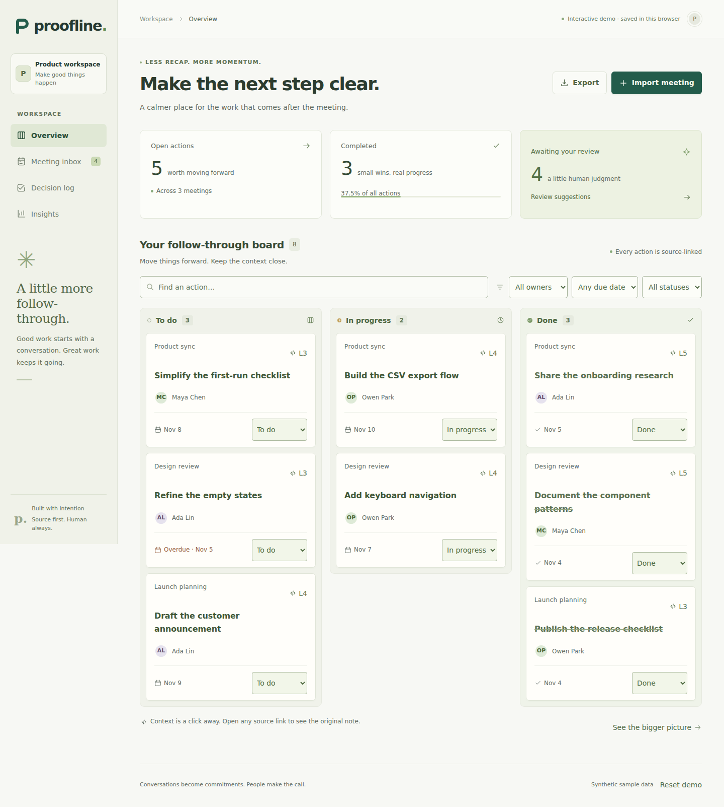
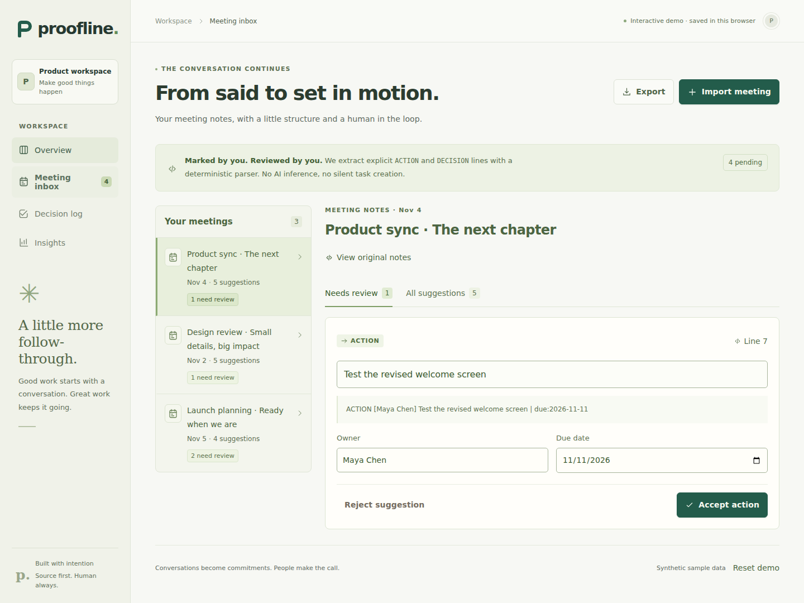

# Proofline

**Turn marked meeting notes into reviewed, evidence-linked follow-through.**

[](https://github.com/Harshiv2718/proofline/actions/workflows/ci.yml)

**[Try the interactive demo](https://harshiv2718.github.io/proofline/)** · [See the code walkthrough](docs/interview-guide.md) · [Verification](docs/verification.md)

The hosted demo saves synthetic data in your browser. Run the full Django/database application locally with the commands below.



Meeting actions often lose their context when they are copied into a task board. Proofline keeps each suggestion connected to the exact line that produced it. A person reviews the wording, owner and date before an action becomes a task. Decisions remain visible with the meeting, and a small set of metrics explains what has been reviewed and completed.

This student-built project combines a React/TypeScript interface, a Django/Python GraphQL API, relational data, validation, automated tests and repeatable local setup. The demonstration uses synthetic data.

## Try the workflow

1. Open a fresh workspace or load the synthetic sample meetings.
2. Import a meeting title, date and notes with explicit `ACTION` and `DECISION` markers.
3. Compare each suggestion with its source line. Edit the action title, owner or due date, then accept or reject it.
4. Track accepted actions through **To do → In progress → Done**. Filter the board by owner, status and due state.
5. Inspect completion, overdue work and review progress. Every metric has a stated denominator.

The extractor is **deterministic rules, not an AI model**. It runs without API keys or paid services. It deliberately does not interpret ordinary prose such as “Maya will ship this Friday.”



```text
We discussed the first export release.
ACTION [Maya] Draft the CSV export specification | due:2026-11-12
ACTION: Add keyboard navigation
DECISION: Start with CSV before adding spreadsheet formats.
```

Owners and due dates are optional. Dates use `YYYY-MM-DD`. See the [complete grammar and API contract](docs/api.md).

## Run locally

Requires Python 3.12+, Node 24.22.1+ and npm. The commands below assume a POSIX shell.

```bash
make setup
make dev
```

Open `http://localhost:5173`. Vite proxies `/api/` and `/graphql/` to Django on port 8000, so session cookies and CSRF checks stay on the same browser origin. SQLite is the default database. The backend entry point is `config.wsgi:application` from the `backend` directory.

For the containerized stack with PostgreSQL 16, Django/Gunicorn and Nginx:

```bash
docker compose up --build
```

Open `http://localhost:8080`. The Compose file is for **local HTTP development** and binds the web port to loopback. Its database password and Django debug defaults are public development settings. PostgreSQL data lives in a named Docker volume.

For a browser-only demonstration:

```bash
make demo
```

This separate mode uses browser local storage and synthetic sample data; it does not call Django or demonstrate server-side isolation. Its visible demo label identifies the mode. The full-stack mode uses the session-scoped database API.

## Verify

```bash
make test
make test-browser
```

The backend suite exercises parser boundaries, exact source preservation, validation, duplicate imports, repeat reviews, workspace isolation, CSRF, transaction rollback, stale task versions and metric calculations. Frontend tests exercise the UI and data adapters. Browser tests exercise user flows through the rendered application. See the CI workflow for the configured database checks.

To run only the backend checks:

```bash
.venv/bin/python backend/manage.py check
.venv/bin/python backend/manage.py makemigrations --check --dry-run
.venv/bin/python backend/manage.py test followthrough
```

The checked-in [GraphQL SDL](backend/schema.graphql) is generated from the running schema:

```bash
cd backend
../.venv/bin/python manage.py graphql_schema --out schema.graphql
```

## Design choices

- **Evidence before automation.** Suggestions preserve the complete source line and its 1-based line number. Reviewing an action creates a task; accepting a decision does not.
- **Explicit state transitions.** Reviews are final and replay-safe. A task carries a version number so a stale browser tab cannot silently overwrite a newer status.
- **A small relational model.** Workspace → Meeting → Suggestion → Task relationships and database constraints protect import and task uniqueness.
- **Transparent metrics.** Completion is done tasks divided by all tasks. Review progress is accepted or rejected suggestions divided by all suggestions. Overdue excludes completed tasks and items due today.
- **Bounded scope.** A workspace supports 100 meetings, 100 marked suggestions per meeting and 500 tasks. Notes are limited to 20,000 characters.

[Product specification](docs/product-spec.md) · [Architecture](docs/architecture.md) · [API and grammar](docs/api.md) · [Interview walkthrough](docs/interview-guide.md)

## Privacy, scope and hosting

The full-stack app has one anonymous workspace per browser session. The session cookie is the access mechanism: there are no user accounts, shared teams, invitations, permissions or cross-device synchronization. Clearing cookies or letting the 30-day session expire loses browser access to that workspace and leaves the underlying meeting records in the database. The interface downloads JSON workspace snapshots or CSV task exports. Retention scheduling, workspace recovery and server-side deletion are outside this version's scope. Use synthetic or non-sensitive notes for evaluation.

This repository is runnable software, not a claim of production readiness. Before public hosting, configure HTTPS, private secrets, explicit allowed hosts, trusted proxy/origin settings, backups, retention/deletion, abuse controls and an appropriate identity model. `DJANGO_DEBUG=false` requires a non-default `DJANGO_SECRET_KEY` and turns on secure cookies. The local Compose configuration intentionally stays in debug mode for HTTP development. The GraphQL browser IDE is disabled when debug is false.

Environment variables are documented in [.env.example](.env.example). Django reads the process environment; it does not automatically load that file. `DATABASE_URL` optionally selects PostgreSQL; otherwise `SQLITE_PATH` can override the SQLite location. PostgreSQL URLs support the optional `sslmode` parameter.

## Development and attribution

AI tools assisted with scaffolding, implementation, tests and documentation. The repository makes its behavior inspectable through source code, a checked-in schema and executable checks. AI-assisted development is separate from the product: Proofline contains no LLM integration, learned extractor or hidden inference service. The interview guide is intended to support an honest explanation of the code and its tradeoffs.
