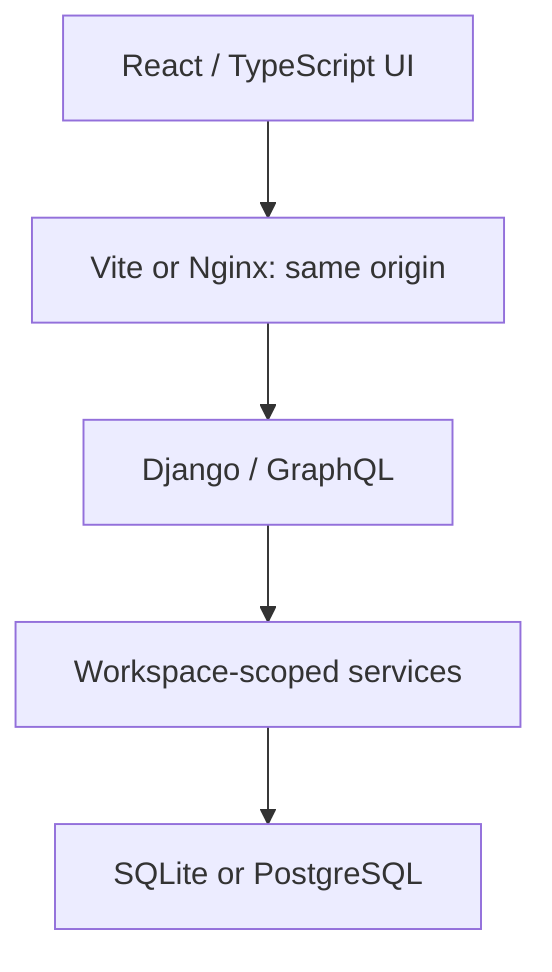
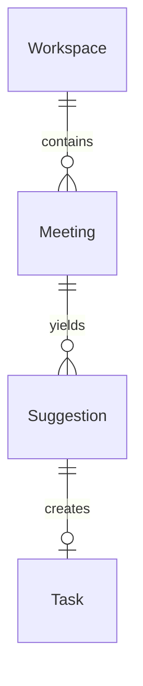

# Architecture

Proofline serves a narrow but complete workflow: preserve meeting notes, extract explicit markers, review them, track accepted actions, and calculate visible progress from current data.

## Request and data flow

`GET /api/session/` establishes a Django database-backed session, associates it with a workspace, and returns a masked CSRF token. The frontend sends that token in `X-CSRFToken` on GraphQL POSTs. The workspace is looked up from the session; no GraphQL field accepts a workspace identifier.

The GraphQL module shapes requests and responses. The services module owns validation, scope, transactions and transitions. The parser is a pure function with a small explicit grammar. Django models and migrations define the relational constraints. The separate browser demonstration adapter implements the same visible workflow in local storage and is labeled as a demo.

## Relational model

| Entity | Responsibility | Integrity rule |
| --- | --- | --- |
| Workspace | Anonymous browser-owned data boundary and demo seed flag | UUID held in a Django session, never trusted from GraphQL input |
| Meeting | Original notes, title, date and creation time | Unique `(workspace, import_hash)` |
| Suggestion | Parsed kind, editable proposal, source and review state | Unique `(meeting, source_line)` |
| Task | Reviewed action, current status and optimistic version | One-to-one with its originating suggestion |

Tasks obtain meeting identifiers and source excerpts through the suggestion relationship. This avoids a second editable copy of evidence. The original notes and source quote remain unchanged when a reviewer edits a suggestion title, owner or date.

## Import and review

Imports validate the entire input and parse every recognized line before writing. A failure in one marked line rejects the whole import. Unrecognized prose remains in the stored notes and yields no suggestion.

The import hash covers normalized title, date and notes. Title normalization strips/collapses whitespace and ignores case. Note normalization converts line endings to LF, strips trailing whitespace per line and removes surrounding blank space. Interior whitespace and note letter case remain significant. A duplicate returns the first meeting with `duplicate: true`; the exact original notes from that first import are preserved. The same input in another workspace is a separate meeting.

Reviews transition from `PENDING` to `ACCEPTED` or `REJECTED`. Repeating the same final decision returns the existing result and ignores new edits. Attempting the opposite final decision returns `CONFLICT`. Acceptance of an action creates one task in the same transaction as the review update. An accepted decision remains a decision, with no task. A unique one-to-one constraint prevents a second task for the same suggestion.

## Concurrency

Import, review and demo seeding lock their workspace row inside a transaction. PostgreSQL uses the row lock to serialize those writes in a workspace. SQLite does not implement row-level `SELECT FOR UPDATE`; its configured `IMMEDIATE` transaction mode acquires the database write reservation before the service reads, avoiding read-to-write lock-upgrade races between duplicate imports or reviews. SQLite serializes writes across the database and waits up to 20 seconds for a lock. It remains suitable for local, low-concurrency use; sufficiently long competing transactions can still time out. The uniqueness constraints independently protect persisted integrity.

Task updates use an atomic conditional SQL update: match task ID and `expectedVersion`, set status and increment version. A stale version matches zero rows and returns `CONFLICT`, preserving the newer value. The frontend can refresh and let the person retry deliberately. Every successful status update increments the version, including a repeated status.

The tests verify transaction rollback after a simulated task-creation failure and version conflicts. They do not claim a load-tested throughput figure or exhaustive concurrent-client testing.

## Metrics

Metrics are computed from the current workspace data with a UTC date boundary, returned as `asOf`. Rates round to the nearest tenth of a percentage point, with exact midpoints rounded up (`1/16` becomes `6.3%`). They are snapshots, not historical analytics or measured user productivity.

| Metric | Definition |
| --- | --- |
| `totalTasks` | Number of tasks created by accepting actions |
| `doneTasks` | Tasks currently in `DONE` |
| `overdueTasks` | Tasks with a due date before `asOf` and status other than `DONE` |
| `completionRate` | `100 × doneTasks / totalTasks`, rounded to one decimal; zero if no tasks |
| `reviewRate` | `100 × (accepted + rejected suggestions) / all suggestions`, rounded to one decimal; zero if no suggestions |
| `pendingSuggestions` | All suggestions still in `PENDING`, including decisions |
| `meetingsCount` | Meetings in this workspace |

The demo adapter uses the same UTC day semantics. Owner, due-state and status filters affect the board display; the workspace metrics retain their full-workspace denominator.

## Scope and safeguards

- UUID object lookups are scoped through the session workspace before returning or changing data. Unknown IDs and IDs from other workspaces return the same `NOT_FOUND` error.
- CSRF middleware remains enabled. Mutations use POST; Graphene rejects mutations over GET. A same-origin proxy avoids a permissive cross-origin API.
- Input and object counts are bounded. Notes remain plain text. The browser renders source excerpts as text, not HTML.
- Debug-free startup requires an explicit secret; secure cookies are enabled in that mode. The GraphQL IDE is debug-only.
- Session expiration or clearing cookies removes access, not stored records. The project has no account recovery, automatic retention, deletion UI or multi-user authorization model.

The current backend limits dashboard size with workspace object caps rather than pagination. A larger or public product would need identity and workspace membership, retention/deletion, rate and query-complexity limits, pagination, operational telemetry and deployment hardening. The implementation deliberately does not claim those capabilities.

## Code map

| Location | Purpose |
| --- | --- |
| `backend/followthrough/parser.py` | Explicit grammar and source preservation |
| `backend/followthrough/services.py` | Validation, scope, transitions, seed data and metrics |
| `backend/followthrough/schema.py` | GraphQL types, mutations and safe application errors |
| `backend/followthrough/models.py` | SQL model and constraints |
| `backend/followthrough/tests/` | Parser, service and HTTP/GraphQL checks |
| `backend/config/settings.py` | SQLite/PostgreSQL selection and local/security defaults |
| `frontend/src/data/` | Typed server and browser-demo adapters |

## References

- [Django 5.2 release and Python support](https://docs.djangoproject.com/en/5.2/releases/5.2/)
- [Django transactions](https://docs.djangoproject.com/en/5.2/topics/db/transactions/)
- [Django CSRF protection](https://docs.djangoproject.com/en/5.2/ref/csrf/)
- [Django test runner](https://docs.djangoproject.com/en/5.2/topics/testing/overview/)
- [Graphene-Django testing](https://docs.graphene-python.org/projects/django/en/latest/testing/)
